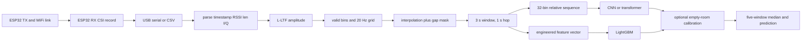

# V3 CSI protocol and minimum-feature audit

**Scope:** read-only audit of the current V3 implementation and available
recordings. This document does not claim that an untested feature improves the
model, and it does not replace the existing V3 results or checkpoints.

## Executive findings

1. The current deployable deep-model input is a `float16` relative-amplitude
   tensor shaped `[32, 60]`: 32 linearly resampled subcarrier bins, 60 samples,
   at 20 Hz over 3 seconds. A parallel `bool[60]` gap mask is produced.
2. Missing time bins are linearly interpolated in the numeric signal, but the
   mask is retained. The transformer consumes the mask as padding tokens and
   random fine-tuning masks; the CNN currently ignores it.
3. The LightGBM input is a compact engineered feature vector: relative CSI
   motion, robust dispersion, differences, range, PCA/eigen-spectrum, spectral
   bands, periodicity, autocorrelation, subcarrier correlation, and RSSI
   dynamics. Absolute RSSI is intentionally not used.
4. The ESP32 naturally produces an irregular packet stream, not a native 20 Hz
   stream. `preprocess.to_uniform_grid()` bins packets at 20 Hz, averages
   collisions, interpolates empty bins, and marks them as missing.
5. V3 evidence supports measured room, hardware, and channel-transfer tests.
   It does not establish universal occupancy accuracy, and it does not show
   that phase, complex CSI, or every engineered feature is useful.
6. Before feature ablation, fix or test index alignment after filtering rows:
   several experiment paths retain a filtered DataFrame's original index while
   indexing NumPy `seq` arrays positionally. This is especially relevant in
   calibrated N1 paths.

## 1. Current implementation: exact protocol

### Acquisition

The intended hardware is two ESP32 boards: a transmitter sends a regular
packet, and a receiver measures CSI for received packets and streams records
over USB serial. The repository firmware documentation specifies an ESP32
receiver/transmitter pair, 802.11n HT20, a 100 Hz transmitter beacon, and
460800 baud for the capture script. The receiver can scan for the quietest
channel or deliberately select the most congested channel.

The exact parser contract is implemented in
[esp32_io.py](../src/esp32_io.py): `parse_raw_lines()`,
`read_espcsi_csv()`, `read_logger_csv()`, and `lltf_amplitude()`. Supported raw
I/Q buffer lengths are 104 values (52 complex bins), 128 values (64 complex
bins), and 384 values (L-LTF plus HT-LTF). The parser retains the L-LTF part.
Each usable packet needs a timestamp, RSSI, declared CSI length, and raw
interleaved I/Q values. The capture firmware's amplitude-only short line is not
equivalent to the full parser contract without an adapter.

### Signal representation

`lltf_amplitude()` computes $|H|=\sqrt{I^2+Q^2}$. V3 does not use phase or raw
I/Q in the current models. `preprocess.valid_subcarriers()` removes bins whose
median amplitude is below `0.15` or above `4.0` times the typical bin level.
`features.relative_fluctuation()` then divides each remaining bin by its
window median and subtracts one, clipping robust outliers at six MADs.

### Resampling and missing packets

`preprocess.to_uniform_grid()` performs the following operations:

* chooses `n=floor(last_time * 20)+1` bins;
* maps packets to `floor(time * 20)`;
* averages packets landing in the same bin;
* linearly interpolates empty bins;
* returns `missing = hits == 0`.

The same operation is applied to RSSI. `build.stream_windows()` creates a
3-second window (`60` samples) every 1 second, stores the window missing ratio,
and returns a gap mask aligned to the sequence. It calls `features.cnn_input()`
to linearly resample the surviving subcarriers to 32 bins.

### Model paths

* **LightGBM:** receives `features.window_features()` plus
  `features.rssi_features()`; it does not receive the sequence or gap mask.
* **CNN:** receives `[batch, 32, 60]`; `CNN1D.forward(x, gap=None)` ignores
  `gap`.
* **Transformer:** receives `[batch, 32, 60]` and `[batch, 60]`; `CSITransformer`
  replaces gap positions with a learned padding token and uses attention
  pooling. Fine-tuning also masks 0-30% of real time steps.

The saved V3 final files and their hashes are verified in
[v3_artifact_manifest.json](../results/v3_artifact_manifest.json). The N*.json
files are held-out protocol results; the final files were trained afterward on
the full final pool and must not be described as the exact held-out checkpoints.

### Calibration and smoothing

`calibrate_v3.calibrate_all()` defines a site as dataset, room, chip, and
channel. It uses the first 30 seconds of an empty recording as reference,
calibrates energy features by log-ratio, and divides each sequence bin by its
reference robust level. Reference windows are excluded from scoring. The
uncalibrated historical `calibrate.py` path uses 20 seconds and feature-only
calibration; it must not be confused with the V3c protocol.

`experiments_noise.smooth()` applies a five-window rolling median within each
recording. At a 1-second hop this is a causal warm-up followed by roughly
five-second temporal context. The current result JSONs report window and
smoothed metrics, but do not separately report detection delay.

### Data flow

## 2. Prediction requirements

| Task | Labels | Minimum physical evidence required |
| --- | --- | --- |
| Presence | empty / occupied | Stable room-specific channel response plus a change that generalizes beyond empty-room background variation |
| Motion state | empty / stationary / moving | Presence evidence plus temporal shape and rate differences; stationary occupants may differ from empty room only subtly |

The 3-second window, 1-second hop, 20 Hz grid, 32 bins, and five-window
smoother are implemented constants in `build.py`, `deep.py`, and
`experiments_noise.py`. The 30-second reference is implemented in
`calibrate_v3.py` for N1c-N3c.

Empty-room fluctuations overlap stationary-person fluctuations because radio
background traffic, AGC changes, appliances, fans, multipath, and receiver
noise continue when no person is present. Therefore total movement energy is
not a sufficient occupancy feature. The useful distinction is more likely to
be a combination of temporal shape, subcarrier distribution, periodicity,
room-relative normalization, and packet/radio context.

## 3. Feature inventory

| Feature or field | Derived from | Presence relevance | Motion relevance | Noise sensitivity | Runtime | Classification |
| --- | --- | --- | --- | --- | --- | --- |
| Raw I/Q | CSI `data` | Enables reproducible derivation | Enables future phase/complex tests | High to formatting/AGC issues | Low-medium | Required for a lossless capture archive |
| L-LTF amplitude | I/Q | Current supported representation | Current supported representation | Medium | Low | Required for V3 compatibility |
| Timestamp and packet sequence | ESP32 metadata | Windowing and stream health | Gap and delay analysis | High to resets/wraps | Low | Required |
| RSSI dynamics | RSSI | Useful secondary cue; absolute RSSI is excluded | Can reflect movement or radio changes | High to channel/load changes | Low | Strong candidate, test as a group |
| Gap mask/missing ratio | packet arrival times | Distinguishes missing data from signal state | Important under interference | Directly affected by congestion | Low | Required for interpretation; transformer input |
| Relative per-bin amplitude | amplitude window median | Removes static gain/room response | Main current sequence signal | Medium | Low | Current baseline |
| Std/MAD/difference/range | relative amplitude | Measures occupancy-induced change but confounds noisy empty rooms | Strong motion candidate | High | Low | Strong engineered candidate |
| PCA spectrum/effective rank | relative amplitude across bins | Captures spatial/frequency shape | Strong candidate for number/type of movers | Medium | Medium | Strong engineered candidate |
| Spectral bands/centroid/entropy | PCA time series | May separate background from occupancy shape | Candidate for slow versus fast motion | Requires defensible 20 Hz grid | Medium | Strong candidate, ablate |
| Periodicity features | PCA spectrum and ACF | May reject fans/AC as non-human background | Useful for repetitive motion | Sensitive to short windows and interpolation | Medium | Optional candidate |
| Cross-subcarrier correlation | relative amplitude | Shape can transfer better than absolute energy | May identify distributed motion | Sensitive to invalid-bin selection | Low | Optional candidate |
| Complex phase | raw I/Q | Potential multipath cue | Potential fine motion cue | Very high: CFO/SFO and chip dependence | Medium-high | Defer until phase calibration exists |
| Channel/bandwidth/chip/session | packet/session metadata | Diagnoses shift; dangerous shortcut | Diagnoses shift | Not a causal occupancy signal | Low | Diagnostic only; do not train by default |

The existing feature implementation is in
[features.py](../src/features.py): `_motion`, `_pca`, `_spectrum`,
`_periodicity`, `_corr`, `rssi_features`, and `cnn_input`.

## 4. Minimum-feature experiment plan

Do not select features on the final held-out test recordings. Define the groups
first, select on training-only grouped validation, and run each locked choice
once on N1-N4 and their calibrated counterparts.

### Baselines and ablations

| ID | Input | Purpose |
| --- | --- | --- |
| A | Existing LightGBM features | Current engineered baseline |
| B | 32-bin amplitude sequence, no gap input | Isolate the current CNN-style signal |
| C | Sequence plus gap mask | Test whether packet validity helps; transformer already supports this |
| D | Motion statistics only | Test compact energy/dispersion features |
| E | D plus PCA/correlation shape | Test cross-subcarrier structure |
| F | D/E plus spectrum and periodicity | Test temporal frequency structure |
| G | D-F plus RSSI and packet metadata | Quantify radio-context benefit and shortcut risk |
| H | Raw I/Q or calibrated phase | Research-only until phase quality is verified |

Run each group with the same recording-level splits, seed set, class weights,
windowing, smoothing, and calibration policy. Report both unsmoothed and
smoothed scores. Include a paired bootstrap or recording-level confidence
interval where enough independent recordings exist.

### Metrics and acceptance criteria

For presence report balanced accuracy, sensitivity/recall for occupied,
specificity, false-alarm rate on empty windows, macro-F1, confusion matrix,
and 95th-percentile prediction latency. For motion report per-class recall,
macro-F1, balanced accuracy, and the three-class confusion matrix. Report the
change caused by the five-window smoother: false-alarm change, occupied recall
change, and first-detection delay.

Prefer a reduced feature set only when it maintains or improves held-out
cross-room and congested-channel performance, does not materially increase
empty-room false alarms, and reduces runtime or data requirements. Training
accuracy alone is not an acceptance criterion.

### Leakage controls

Split by complete recording, room, or session before any feature selection.
Never randomly split overlapping windows from one recording. Fit calibration
references only on the permitted empty calibration interval. Do not use channel,
room, recording name, or hardware ID as a predictive input unless the explicit
experiment is measuring a deployment shortcut. Keep WiGesture/WiFall
self-supervised pretraining separate from claims about supervised held-out
noise conditions.

## 5. Dataset compatibility

| Dataset | Raw representation | Labels/metadata | Best use |
| --- | --- | --- | --- |
| ESPectre | ESP32 CSI records with real-home conditions | Empty/static/moving, rooms, chips | N1 room/hardware shift and final V3 training |
| esp32-csi-pipeline | ESP32 records in quiet and congested channel conditions | Room, channel condition, motion/presence | N2/N3 measured noise evaluation |
| WiCount | ESP32-S3 amplitude-derived I/Q CSV, about 100 Hz | 0-3 people, meeting room | Counting/reference training; not V3 noise proof |
| WiGesture/WiFall | ESP32 CSI CSV | Gesture/fall/activity labels | Transformer masked pretraining and activity representation |
| OTH thesis | ESP32 logger CSI, ESP-NOW HT40 | 0-3 count labels | Cross-hardware/reference data |
| OpenCSI | Mesh links with bursty approximately 1 Hz per link | Empty/static/moving | Retained for future burst-aware model; not current V3 input |
| HomeOccupancy | ESP32-C6 raw I/Q CSV, about 200 Hz irregular packets | Empty/sleep/work, one home, file split | V4 temporal home-domain fine-tuning |

Conversion can lose original packet rate, multiple links, phase fidelity, or
hardware-specific metadata when a source is mapped to one 20 Hz, 32-bin stream.
Those losses must be recorded in the dataset manifest rather than hidden.

## 6. Recommendations and roadmap

### Implement first

1. Add a live parser/adapter test using one captured raw line from the actual
   receiver firmware and assert the exact full record schema.
2. Add packet-quality counters, timestamp-wrap tests, stable-length checks, and
   explicit gap-mask tests.
3. Fix or assert DataFrame/NumPy index alignment after row filtering in the
   calibrated experiment paths.
4. Run ablations A-G with grouped validation and record-level metrics.

### Defer

Phase/complex CSI should wait for phase-offset calibration and a chip-held-out
test. Metadata should remain diagnostic until an ablation proves it generalizes
without identifying sessions. Larger transformers are not justified before the
input contract and feature groups are stable.

### Files to add in the experiment phase

* `V3/src/feature_ablation.py`: locked feature-group registry and grouped splits.
* `V3/src/metrics_noise.py`: specificity, sensitivity, false alarms, delay, and
  confidence intervals.
* `V3/tests/test_protocol.py`: raw-line, timestamp-wrap, malformed-packet,
  gap-mask, and tensor-shape tests.
* `V3/results/feature_ablation_*.json`: one immutable result per protocol and
  feature group.

## Evidence status

**Implemented fact:** the current parser, resampler, window sizes, feature
groups, model inputs, calibration functions, smoothing, saved artifacts, and
N1-N4 split definitions described above.

**Measured evidence:** V3's existing raw/calibrated JSON results and five
figures on ESPectre and pipeline recordings.

**Research hypothesis:** phase, periodicity, RSSI/gap metadata, and compact
feature subsets may improve cross-room or non-human-noise robustness.

**Required before a deployment claim:** live receiver schema validation,
quality gates, grouped feature ablations, detection-delay measurement, and a
target-room recording with the final hardware placement.