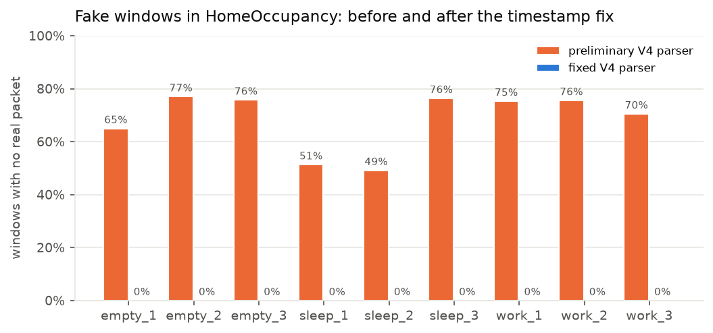
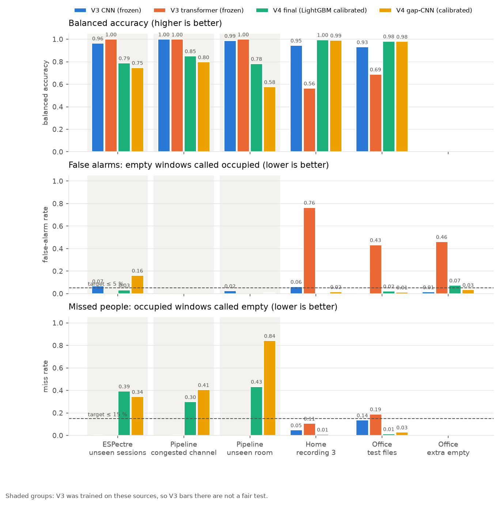
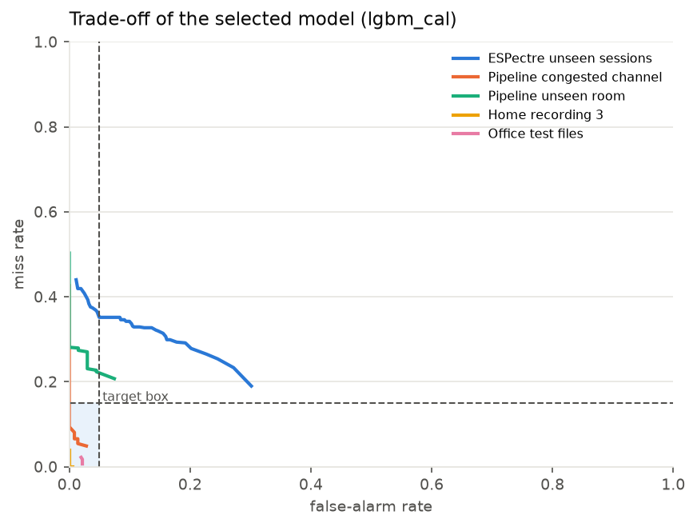
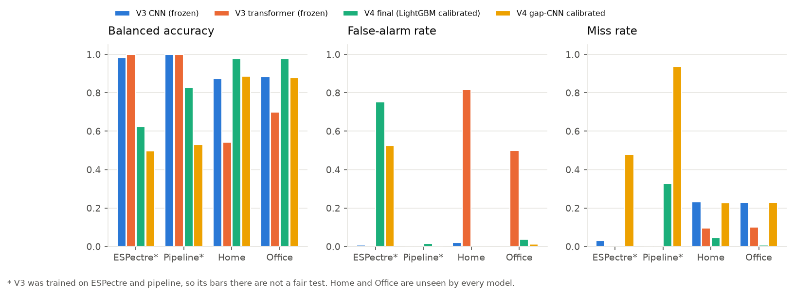
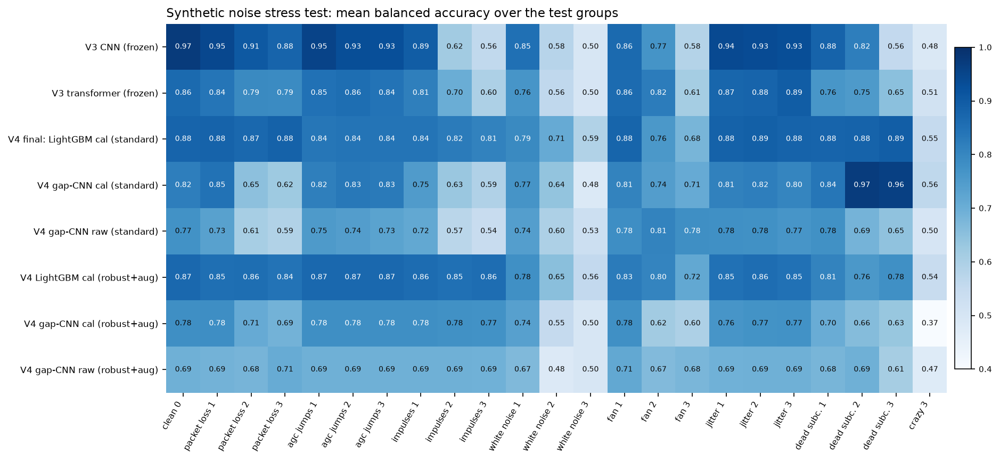
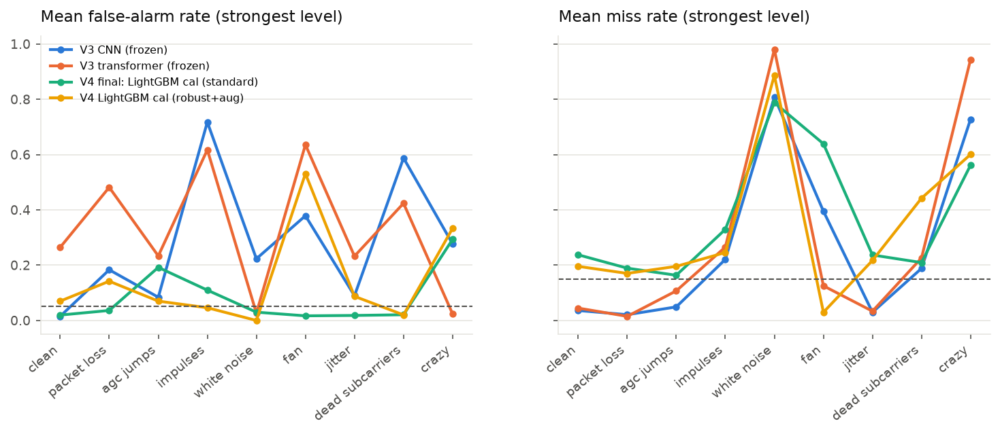
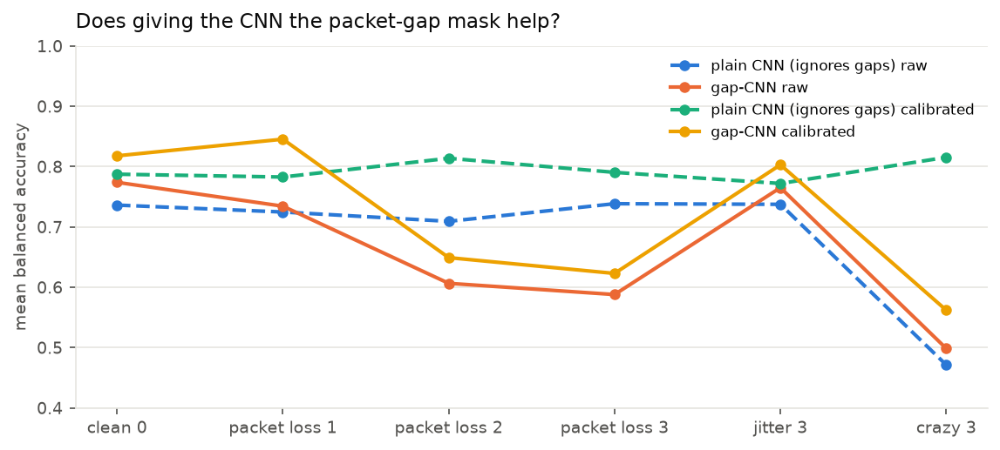
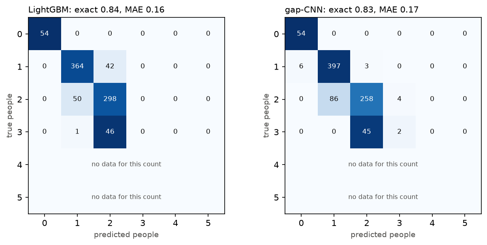
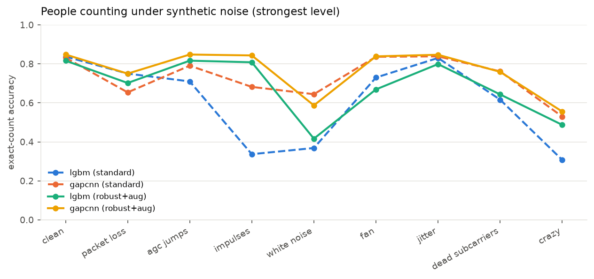

# V4 report: Wi-Fi presence detection and people counting with ESP32

*18 October 2026. Every number here comes from a saved result file; the list of runs is in
`results/metrics/summary.json` and `manifests/experiment_registry.json`.*

## 1. Short answer

- **V4 fixed two serious hidden bugs.** One was in the data and one was in the saved V3 model. Both are explained in section 3.
- **People present or not (presence):**
  - On two homes and offices that no model had seen, V4 beats V3 clearly: 0.98 vs 0.87–0.89 balanced accuracy.
  - There it meets the targets of at most 5 % false alarms and at most 15 % missed people.
  - In other homes and other chips (ESPectre) it still misses too many people (39 %).
- **Counting people:**
  - 0, 1 and 2 people work well: about 83–85 % exact, and the count is off by more than one person almost never.
  - 3 people is almost never recognised, because only one 60 s recording of 3 people exists.
  - 4 and 5 people cannot be trained: no ESP32 data with 4–5 people exists anywhere we can download.
- **Crazy noise:**
  - V4's final model survives spikes, dead subcarriers, packet loss, jitter and gain jumps much better than V3.
  - Strong white noise, strong fan ripple and "everything at once" still break every model.
- **Status: V4 is experimental. V3 stays the official baseline.** Promotion needs a test in your own room (section 8).

## 2. What V4 is

| Part | V4 choice |
|---|---|
| Input | raw ESP32 CSI (`CSI_DATA` lines), amplitude of the 52–64 L-LTF subcarriers |
| Clean-up | bad rows removed, clock repaired, 20 samples per second, 3 s windows every 1 s |
| Quality gate | a window with a packet gap > 0.5 s or > 25 % missing steps is **"unknown"**, never guessed |
| Calibration | 30 s of empty room after installing; every later window is compared with it |
| Presence model | **LightGBM** (gradient-boosted trees) on 35 signal features, calibrated, threshold 0.90, 5-second median smoothing |
| Counting model | LightGBM and a small **gap-aware CNN**, outputs 0–5 |
| Latency | about 3 ms to process a window plus 2–4 ms per model; a change is first reported after 3–5 s |

The final presence model was chosen by a rule fixed in advance (`configs/v4_protocol.json`):

1. Take the model with the best **validation** score.
2. Average that score over clean data and all 22 noise conditions.

Test data was not looked at when choosing. The model card is `models/presence/MODEL_CARD.json`.

## 3. Two hidden bugs (found and fixed)

### 3.1 Most HomeOccupancy windows were fake

A few timestamps in the HomeOccupancy files are garbage numbers (about 9 × 10¹⁷). The
preliminary V4 code "unwrapped" the clock *before* removing them. Each recording then looked
3–5 times longer than it really was, and the empty time was filled with straight lines.

*Figure 1. Share of windows with no real packet in them. Before the fix: 49–77 %. After: 0 %.*

So the earlier "V4 fine-tune" results (0.49 / 0.48) were measured on mostly fake data and are
withdrawn. Their files are kept in `archive/V4_removed_2026-10-18/`.

The fix is in `data.clean_timestamps`, and it is checked by tests:

1. Impossible values are removed first.
2. Then isolated spikes are removed.
3. Only then is the clock unwrapped.

The same check found that OfficeLocalization `empty_4` and `empty_5` print the clock as a signed
number. Those values are now converted back instead of the files being thrown away.

### 3.2 The saved V3 LightGBM had the answer as an input

V3's saved presence and motion LightGBM files were trained with the **label column itself**
(`motion_id`) as an input. It carries 97 % and 94 % of their decisions. In real use that column
does not exist. Fed honestly, the V3 LightGBM says "empty" for every window: it misses 100 % of
people.

V3's *published* experiment numbers are not affected, because those scripts removed the column
correctly. Only the saved deployment files are broken. V3 is frozen, so it is left as it is and
recorded here.

## 4. Presence (empty or occupied)

### 4.1 Data and splits

| Source | Train | Validation | Test |
|---|---|---|---|
| ESPectre (real homes, 5 chip types) | dataset's `train` | dataset's `selection` | dataset's `holdout` (unseen sessions) |
| Pipeline | room 1, quiet channel | – | room 1 on the **most congested channel**; room 2 |
| HomeOccupancy | recording 1 | recording 2 | recording 3 (looked at before, so it is a "development" test) |
| OfficeLocalization | recording 1 | empty_3 | recording 2 (**never used before**); empty_4 and empty_5 (false alarms only) |

Splits are made per recording before any window is cut, so a window never crosses from
training into testing. A test checks this.

### 4.2 Results on the test groups

*Figure 2. Same windows for every model. The shaded groups were part of V3's training data, so
V3's near-perfect bars there are not a fair test.*

| Test group | V4 final: balanced accuracy | false alarms | missed people |
|---|---|---|---|
| ESPectre unseen sessions | 0.79 | 3 % | **39 %** |
| Pipeline, congested channel | 0.85 | 0 % | **30 %** |
| Pipeline, unseen room | 0.78 | 0 % | **43 %** |
| Home recording 3 | 0.99 | 0 % | 1 % |
| Office test files | 0.98 | 2 % | 1 % |
| Office extra empty recordings | – | **7 %** | – |

In plain words, V4 is *careful*: it rarely calls an empty room occupied. In the harder homes it
often fails to notice a person, especially a still one. The trade-off figure shows that no threshold fixes
ESPectre:

*Figure 9. Every threshold of the final model. Lower-left is better; the blue box is the
target. Home, Office and the congested channel reach the box; ESPectre and the unseen pipeline room cannot.*

Per recording, results spread a lot. Among the ESPectre test recordings, most are 100 % right,
but a few are 0 % right.

### 4.3 The fair V3 vs V4 test (one dataset left out completely)

Here V4 is trained **without** the target dataset at all, exactly as V3 never saw Home or Office.

*Figure 3. Leave-one-dataset-out. Threshold fixed at 0.5. Home and Office are the fair comparison.*

| Left-out dataset | V3 CNN | V3 transformer | **V4 final** |
|---|---|---|---|
| Home | 0.87 (misses 23 %) | 0.54 (false alarms 82 %) | **0.98** (false alarms 0.1 %, misses 4 %) |
| Office | 0.89 (misses 23 %) | 0.70 (false alarms 50 %) | **0.98** (false alarms 4 %, misses 1 %) |
| Pipeline | (seen by V3) | (seen by V3) | 0.83 (misses 33 %) |
| ESPectre | (seen by V3) | (seen by V3) | **0.62 (false alarms 75 %)** |

**V4 wins the fair comparison and meets both targets there.** One caveat: Home and Office
come from the same research group with the same ESP32-C6 setup, so this shows "new room,
similar hardware". When the many-chip ESPectre data is left out, V4 fails. Different chips
are still the biggest weakness.

## 5. Crazy noise stress test

Eight kinds of synthetic noise are added to the raw packets **before** any processing, at three
strengths each:

| Noise | Imitates |
|---|---|
| packet loss | busy Wi-Fi, weak link |
| AGC gain jumps | the ESP32 changing its gain |
| impulses | microwave / Bluetooth bursts |
| white noise | weak signal, far boards |
| fan ripple | fans, AC units, machines |
| jitter | USB / serial timing |
| dead subcarriers | firmware or hardware faults |
| **crazy** | all of the above at full strength at once |

*Figure 4. Mean balanced accuracy over the test groups (darker = better). V3 numbers include
groups V3 was trained on, so its "clean" column looks better than it really is.*

*Figure 5. False alarms and missed people at the strongest level of each noise.*

| Noise at full strength | V3 CNN | V4 final |
|---|---|---|
| impulses | 0.56 | **0.81** |
| dead subcarriers | 0.56 | **0.89** |
| fan ripple | 0.58 | **0.68** |
| white noise, medium | 0.58 | **0.71** |
| packet loss 50 % | 0.88 | 0.88 (and 86 % of windows are honestly reported as "unknown") |
| white noise, strong (SNR 8 dB) | 0.50 | 0.59 |
| crazy | 0.48 | 0.55 |

**What helped:** calibration to the empty room helped most. The quality gate also helped,
because it says "unknown" instead of guessing when packets are missing.

**What did not help (tested and rejected on validation data):**

- **"Robust" preprocessing plus noise-augmented training.** This means per-packet gain
  normalisation, a spike filter, and one noisy copy of every training recording.
  - It fixed impulses for the uncalibrated models (0.53 → 0.71).
  - It made the congested-channel test and the "crazy" test worse.
  - Its validation score was 0.775, against 0.786 for the standard pipeline.
- **The gap-aware CNN.** It is the V4 fix for V3's CNN ignoring missing packets. A test shows
  the fix works mechanically, but it gave **no benefit**: under heavy packet loss it was worse
  than the plain CNN (figure 6).

*Figure 6. Plain CNN vs gap-aware CNN, same data and training.*

Synthetic noise is a stress test, not proof. The only *real* noise measured is the pipeline's
congested channel. There V4 has 0 % false alarms but misses 30 % of people.

## 6. Counting people

### 6.1 Data

Only two ESP32 counting datasets are usable:

- **WiCount:** one meeting room, 0–3 people. There are 15 one-minute recordings, but only one each for 0 and 3 people.
- **OTH room 2:** one minute for each count 0–3.

We searched for more (`manifests/dataset_search.json`):

- **WiFiVision** has 0–7 people on ESP32, but it is **on request**.
- Every open 4–5 person dataset uses other hardware: Intel 5300 (0–8 people) or Raspberry Pi (0–5 people).

Mixing other hardware into ESP32 training would hide the real problem, so V4 does not do it.

### 6.2 Test design

- **Counts 1 and 2:** whole recordings are held out.
- **Counts 0 and 3:** these have one recording each, so it is cut into 3 time blocks, and each block is tested once. This is weaker evidence.

### 6.3 Results

*Figure 7. Counting confusion (rows = true count). Rows 4 and 5 are empty because no data exists.*

| | LightGBM | gap-CNN | gap-CNN, robust + noise training |
|---|---|---|---|
| exact count | 0.84 | 0.83 | 0.85 |
| average error (people) | 0.16 | 0.17 | 0.15 |
| off by more than 1 | 0.1 % | 0 % | 0 % |
| empty room counted as people | 0 % | 0 % | 0 % |
| 3 people recognised | 0 % | 4 % | 4 % |
| another room (WiCount → OTH) | 0.53 | 0.28 | 0.26 |

- **0, 1, 2 people:** reliable in the same room.
- **3 people:** almost always called "2", because there is too little training data.
- **Another room:** fails, as expected.

*Figure 8. Counting under noise. Robust preprocessing plus noise training clearly helps counting:*

- *with impulses, 0.34 → 0.81 for LightGBM;*
- *with "crazy" noise, 0.31 → 0.49 for LightGBM and 0.53 → 0.56 for the CNN.*

*Counting has no separate validation set, so no variant is "selected". Both are reported.*

## 7. What was checked

- **26 automatic tests**, all passing (`python -m unittest discover -s V4/tests -v`). They cover:
  - timestamp repair, malformed rows, window shapes and long-gap handling;
  - label rules: "sleep" is never turned into "static", and unknown labels stop the program;
  - one split per recording, and window/label/sequence alignment after filtering;
  - calibration: the empty reference is never scored and comes from the same split;
  - counting folds never share a recording;
  - the gap-CNN really ignores fake values;
  - model save/load, the noise functions;
  - **V3 is byte-for-byte unchanged** (63 files hashed at the start).
- **Every run is saved with its exact settings** in `results/metrics/<run>/config.json`. Checkpoint hashes are in `manifests/experiment_registry.json`.

## 8. What V4 cannot claim yet

| Claim | Status |
|---|---|
| Works on your ESP32 in your room | **not tested**: no own recordings yet |
| Live ESP32 capture end to end | **not tested**: only recorded files were used |
| 4 or 5 people | **no data**: the model has the outputs but they are untrained |
| Different chips / unseen homes | **weak**: ESPectre left out → 75 % false alarms |
| Real fan / AC / machine noise | only synthetic tests; real recordings needed |
| Home recording 3 | already looked at in the preliminary V4, so it is development evidence only |

## 9. Next steps (in order)

1. **Record your own data** with `docs/COLLECTION_PROTOCOL.md`:
   - 6 or more sessions on 3 or more days, 0–5 people, with a 30 s empty reference each session;
   - check each file with `python V4/src/validate_recording.py`.

   This is the only route to a real 0–5 counter and to promoting V4.
2. **Request access to WiFiVision** (ESP32, 0–7 people) and the **OTH thesis set** (ESP32, 0–3, 120 sessions).
3. Then retrain counting with whole sessions held out, and run the final test once in your room.

## Files

- **Code:** `src/`
- **Settings:** `configs/v4_protocol.json`
- **Numbers:** `results/metrics/`
- **Figures:** `results/figures/` (captions in `captions.json`)
- **Dataset details:** `docs/DATASET_AUDIT.md`
- **How to rerun everything:** `README.md`
