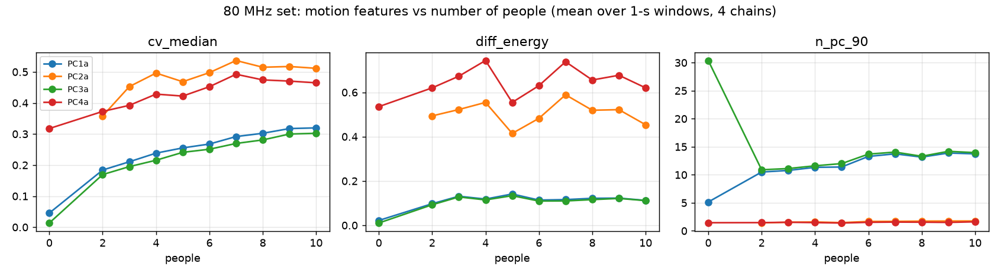
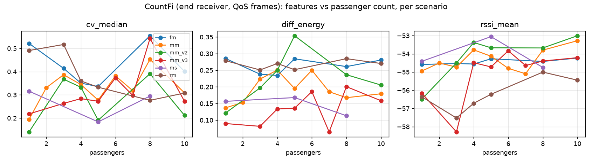

# Deep audit: 80 MHz set (`Dataset/`) and CountFi (`CountFi/`)

**Date:** 2026-10-19 · **Data:** `D:/wifi/Datasets/Dataset` and `D:/wifi/Datasets/CountFi` (read-only, nothing changed)
**Builds on:** [../dataset_audit/DATASET_AUDIT_REPORT.md](../dataset_audit/DATASET_AUDIT_REPORT.md) (file formats, integrity). This report adds what matters for **training a people counter**: how labels are laid out in time, whether the signal really changes with the number of people, and how much leaky splits would fool us.

---

## 1. Bottom line

| | 80 MHz set (`Dataset/`) | CountFi |
|---|---|---|
| Is the count visible in the signal? | **Yes, clearly.** Motion rises steadily with people in all 4 setups (rank correlation 0.83 to 1.0). | **No, not in a way that holds across scenarios.** Features go up in one scenario and down in another. |
| Score on unseen data (honest split) | Unseen setup: average error **1.17 people**, **71 % within ±1** (10-s windows + room calibration) | Unseen scenario: average error **2.0 to 2.3**, no better than always guessing the average |
| Biggest problem | Each room has its own baseline level; 2 of the 4 setups are much noisier | Every count is one block of 1-3 min on one afternoon, so **clock time predicts the count 93 % exactly** |
| Verdict | **Use it. Main training and test set.** | **Do not train a counter on it as is.** Keep only as a side / stress set. |

---

## 2. 80 MHz set (`Dataset/`)

### 2.1 What is there

- 4 setups (PC-1a … PC-4a), counts **0, 2, 3, … 10**. **1 person is missing everywhere.** `PC2a_n00` is empty (no data), so PC-2a has no empty-room recording.
- 39 usable recordings, each **4 to 5 minutes** (230-300 s at 173 packets/s per antenna). About 18 min per count in total.
- 10,477 one-second windows: 883 for count 0, and 950-1,175 for every other count. Well balanced.
- Each recording is one person-count in one setup, so **1 recording = 1 (setup, count) pair**. There is no second recording to test "same room, another day".

### 2.2 Signal checks (new)

| Check | Result |
|---|---|
| Usable tones | 242 of 256 (drop bins 0, 1, 123-133, 255) |
| Antenna order (rows cycle over 4 chains) | Stable in 35 of 39 files. Small slips in PC2a_n04 (1/49 chunks), PC2a_n08 (4/49), PC2a_n09 (4/39), PC2a_n10 (1/45). **PC4a_n10: order changes right after the first chunk (45/46).** Averaging features over the 4 chains makes this harmless. |
| Drift inside a recording | Small. Motion level in the first third vs the last third differs by under 10 % in almost all files. Training on the first 70 % and testing on the last 30 % scores the same as a random split, so time inside a file does not leak. |

### 2.3 Does the signal follow the count?

- **`cv_median`** (how much each subcarrier fluctuates) rises with people in every setup. In PC-1a and PC-3a it rises almost perfectly (rank correlation 1.0) from 0.01-0.05 when empty to 0.30-0.32 at 10 people.
- The rise flattens above about 7 people in PC-2a and PC-4a. Counts above 7 will be hard to tell apart.
- **The setups split into two families:**
  - PC-1a and PC-3a: quiet, with many independent signal patterns (`n_pc_90` ≈ 11-14).
  - PC-2a and PC-4a: about twice the fluctuation, with almost all of it in a single pattern (`n_pc_90` ≈ 1.5). This looks like one strong disturbance unrelated to people, such as gain jumps or interference.
- **`PC4a_n00` is suspicious.** It is labelled empty, but its motion level (0.32) equals 2-3 people in the other setups. Either the PC-4a room had something moving, or this recording is not truly empty. Treat PC-4a's zero with care.

### 2.4 How well can a simple model count? (LightGBM on 7 motion features)

| Split | Exact | Within ±1 | Avg error (people) |
|---|---|---|---|
| Random 1-s windows (leaky) | 0.32 | 0.69 | 1.18 |
| Same file, later in time | 0.32 | 0.70 | 1.16 |
| **Unseen setup, 1-s windows** | 0.18 | 0.52 | 1.66 |
| **Unseen setup, 10-s windows + per-room calibration** | **0.28** | **0.71** | **1.17** |

Whole-recording estimates on an unseen setup (median of 1-s predictions; true counts 0, 2, 3, … 10):

| Setup left out | Predicted |
|---|---|
| PC-1a | 0.8, 2.6, 3.3, 4.4, 5.4, 6.0, 7.0, 7.5, 8.1, 8.4: **almost exactly right** |
| PC-3a | 2.2, 3.1, 4.0, 4.8, 6.0, 6.8, 7.1, 7.3, 7.6, 7.6: right order, about +1 too high at the low end |
| PC-2a | 5.0, 6.3 … 7.3: compressed, everything pulled towards 6-7 |
| PC-4a | 5.5, 6.1 … 7.1: compressed (the noisy family) |

"Per-room calibration" means standardising the features with unlabelled data from the new room. In real use this is a short calibration recording after installation. The test here uses the whole recording, and so assumes that recording contains a similar mix of counts. That makes it a slightly optimistic estimate.

### 2.5 What the 80 MHz set needs

1. **A 1-person class.** It is missing in all setups, so a model trained here cannot learn 0 → 1. CountFi has 1-person data, but from a bus with a different setup (see §3).
2. **Per-room normalisation.** It is the single biggest gain: average error 1.70 → 1.17 together with longer windows.
3. **Windows of 5-10 s, not 1 s.** 1-s windows are too noisy to count.
4. **Use all 4 antennas, averaged or stacked.** This is more robust than one antenna and hides the chain-order slips.
5. **Check PC-4a's empty recording and the noise in PC-2a/PC-4a.** The setup descriptions (`set_names.pdf` on IEEE DataPort) would explain what the setups are. That small download needs your permission.
6. **Expect saturation above about 7 people.** Report ±1 accuracy, not only exact accuracy.

---

## 3. CountFi (`CountFi/48`)

### 3.1 What is there

- 6 scenario codes: `fm`, `mm`, `mm_v2`, `mm_v3`, `ms`, `rm`. Their meaning is undocumented; possibly bus zones or seating layouts.
- 2 receivers per scenario, `head` and `end`. They record **exactly the same seconds** (median offset 1-8 ms, 100 % paired).
- 2,370 one-second files per receiver (4,740 total). Files per count, per receiver:

| Count | 1 | 2 | 3 | 4 | 5 | 6 | 7 | 8 | 10 |
|---|---|---|---|---|---|---|---|---|---|
| Files (≈ seconds) | 286 | 108 | 320 | 452 | 276 | 212 | 66 | 282 | 368 |
| Scenarios that have it | 6 | **1** | 5 | 5 | 6 | 2 | **1** (+1 file) | 6 | 5 |

Counts 2 and 7 exist in only one scenario, so they can never be tested on an unseen scenario. There is no 0 and no 9.

### 3.2 When was it recorded? (new; this is the key finding)

**Everything was recorded on 2025-04-08 between 14:37 and 17:42 (Hong Kong time), about 3 hours.** Inside each scenario, every count is **one continuous block of 1-3 minutes**, recorded one after another:

| Scenario | Order of counts in time |
|---|---|
| mm | 6 → 7 → 5 → 4 → 3 → 8 → 10 → 1 → 2 (14:37-15:27) |
| ms | 8 → 5 → 1 (15:02-15:15) |
| mm_v2 | 8 → 10 → 4 → 1 → 5 → 3 (15:34-15:57) |
| fm | 8 → 10 → 5 → 1 → 4 → 3 (16:16-16:34) |
| mm_v3 | 8 → 10 → 5 → 1 → 4 → 7 → 6 → 3 (16:52-17:13) |
| rm | 8 → 10 → 5 → 1 → 4 → 3 (17:22-17:42) |

Consequences:
- **Count = time block.** A model given only "seconds since the scenario started" predicts the count **93 % exactly**. Any model that can recognise *which minute* a file came from will look excellent on a random split.
- The 1-s files are back-to-back slices of those blocks, so neighbouring files are near-copies.
- Whether the bus was moving, the engine running, or people sitting or walking is unknown and may change between blocks.

### 3.3 Signal checks (new)

- **Frame types.** Use **QoS-data frames only** (about 45 % of packets, about 470 per second). Block-Ack frames are a different CSI type with 4 empty sub-bands.
- **`head` vs `end`.** The head receiver writes non-channel values into bins 125-131, while end does so only in 128-131. Dropping the standard 14 bins (0, 1, 123-133, 255) leaves **the same 242 tones as the 80 MHz set** for both receivers. So the formats are compatible.
- **RSSI** is steady at about -52 to -56 dBm.

### 3.4 Does the signal follow the count?

**No consistent pattern.** The motion feature that works so well on the 80 MHz set goes *down* with passengers in `fm` (−0.83) and `rm/end` (−0.89) but *up* in `mm/head` (+0.68) and `mm_v3/end` (+0.60). Only RSSI tends to rise with passengers in most scenarios, and that is weak.

| Split (LightGBM, 7 motion features + RSSI) | Exact | Within ±1 | Avg error |
|---|---|---|---|
| Random 1-s files (leaky) | 0.18-0.20 | 0.48-0.50 | 1.85-1.91 |
| **Unseen scenario** | 0.14 | 0.40 | 2.20-2.34 |
| Always guess the average (no signal) | – | – | 2.06-2.75 per scenario |
| Clock time only, random split | **0.93** | 0.99 | 0.14 |

Leakage test with the static channel shape (the average spectrum of each second):
- Random split: **0.33 exact**.
- Unseen scenario: **0.14**.

The model learns which recording block a file came from, not how many people are on the bus.

### 3.5 What CountFi needs

1. **Confirmation from the authors that folder number = passenger count**, plus what `fm/mm/ms/rm/v2/v3` mean and whether the bus was moving. Contact: jingtao2023 dot guo at connect dot polyu dot hk.
2. **Repeated, interleaved recordings of each count** on different days. The paper's larger 2023 set (`613_20People.zip`, up to 20 people) may have them; downloading it needs your permission.
3. Until then, **only ever split by scenario, never by file**, and never put `head` and `end` of the same second on different sides.
4. Use QoS frames only, and drop the 14 bins.

---

## 4. Can the two be combined?

- **Format: yes.** Both are Nexmon, 5 GHz channel 42, 80 MHz, with the same 242 usable tones. CountFi has 1 antenna, so use one chain (or the chain average) of the 80 MHz set.
- **Rates differ:** 173 vs about 470 QoS packets/s. Define windows in seconds.
- **Usefulness: limited today.** CountFi's labels do not carry a count signal that holds up across its scenarios, so adding it would mostly add noise. Its one real contribution would be the missing 1-person class, but from a very different environment (a bus).

## 5. Recommendation

1. **Build the first counter on the 80 MHz set only.**
   - Evaluate by leaving one setup out.
   - Use 5-10 s windows, all 4 antennas and per-room calibration.
   - Report average error, ±1 accuracy and per-count recall.
2. Start from the 7 simple motion features (already extracted). Then try a small 1D-CNN on the 242-tone amplitude windows, and keep it only if it beats LightGBM on unseen setups.
3. Keep CountFi as an **out-of-domain stress test** (does the model at least rank more passengers higher?). Don't use it as training data until the label and time issues are resolved.
4. Ask for two things (both need your OK):
   - the 80 MHz `set_names.pdf`;
   - the CountFi authors' answer, or their 2023 dataset.

## 6. Files

| File | What |
|---|---|
| `scripts/features_common.py` | The 7 motion features + 242-tone mask (shared) |
| `scripts/a1_mat80_features.py` | 80 MHz streaming reader, chain-slip check, per-window features → `_work/mat80_features/*.npz` |
| `scripts/c1_countfi_structure.py` | CountFi time/label layout, head-end pairing → `_work/countfi_structure.json` |
| `scripts/c2_countfi_head_vs_end.py` | Head vs end bin profiles → `_work/countfi_head_vs_end.json` |
| `scripts/c3_countfi_features.py` | CountFi QoS features per file → `_work/countfi_features.npz` |
| `scripts/b1_learnability.py` | Correlations, split comparison, time-confound test → `_work/learnability.json`, `figures/` |
| `scripts/b2_countfi_profile_leak.py` | Static-shape leakage test → `_work/countfi_profile_leak.json` |
| `scripts/b3_mat80_calibration.py` | Per-room calibration and 10-s windows → `_work/mat80_calibration.json` |

Run any script with `py -P -E <script> <args>` (usage is in each file's header). Peak RAM is about 250 MB.
